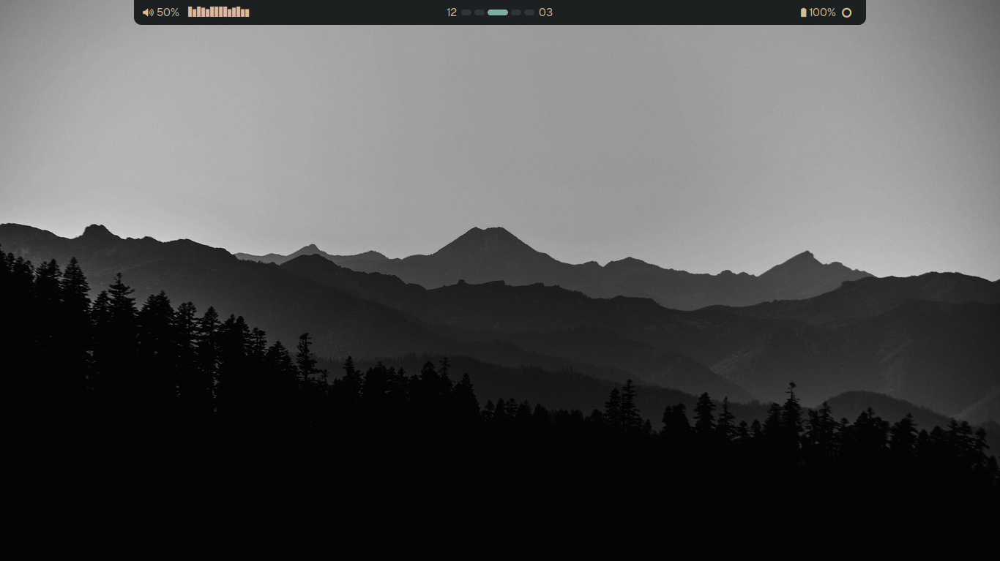
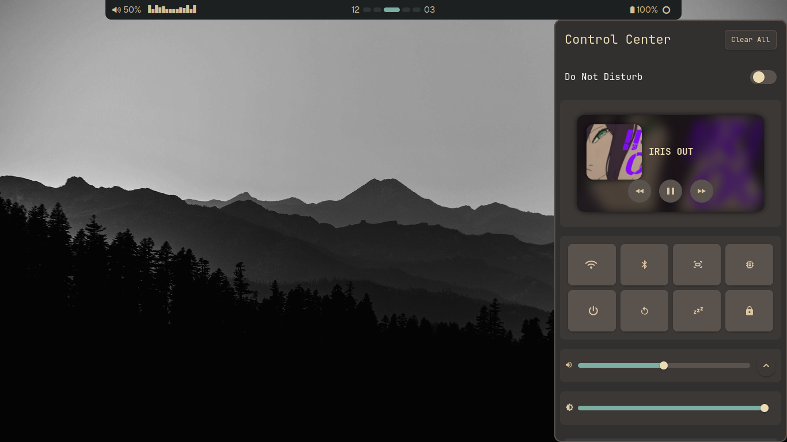
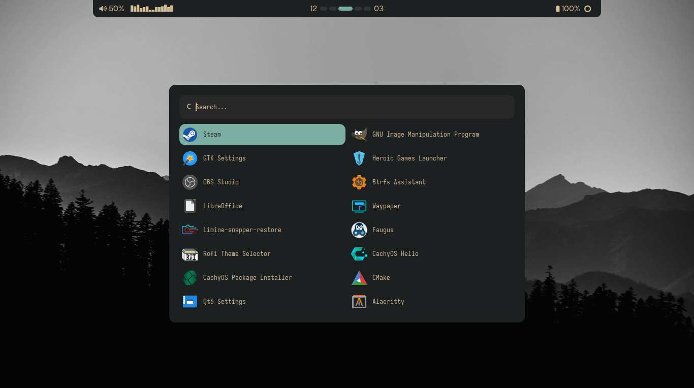

# my hyprland Dotfiles

My personal Hyprland setup on CachyOS. 

## Screenshots







## What's Inside

| Config | Purpose |
|--------|---------|
| `hypr` | Hyprland window manager |
| `waybar` | Status bar |
| `swaync` | Notification daemon |
| `rofi` | Application launcher |
| `kitty` | Terminal emulator |
| `fish` | Shell |
| `starship` | Shell prompt |
| `cava` | Audio visualizer |
| `wifi-manager` | Wi-Fi management (TUI/GUI) |
| `GTK-3.0` | GTK config |
| `GTK-4.0` | GTK config |
| `Gruvbox-Material-Dark` | GTK theme |

## Keybindings

`mainMod` = `SUPER`. Full list in `hypr/binds.lua`.

| Key | Action | Key | Action |
|-----|--------|-----|--------|
| `SUPER + Return` | Terminal | `SUPER + Q` | Close window |
| `SUPER + E` | File manager | `SUPER + F` | Fullscreen |
| `SUPER + Space` | Launcher | `SUPER + G` | Float |
| `SUPER + B` | Browser | `SUPER + M` | Maximize |
| `SUPER + T` | Editor | `SUPER + L` | Lock screen |
| `SUPER + 1–9` | Workspace 1–9 | `SUPER + W` | Wallpaper |
| `SUPER + SHIFT + 1–9` | Move to workspace | `SUPER + V` | Clipboard |
| `SUPER + ←/→/↑/↓` | Focus window | `SUPER + P` | Color picker |
| `SUPER + H/L/K/J` | Focus (Vim) | `SUPER + R` | Reload waybar |
| `SUPER + ALT + ←/→` | Resize H | `Print` / `SUPER + S` | Screenshot |
| `CTRL + ALT + ←/→/↑/↓` | Move window | `SUPER + Tab` | Next workspace |

> **Note:** This configuration uses Hyprland's Lua syntax (0.55+). Keybinds are
> defined with `hl.bind()` in `hypr/binds.lua`. If you're on an older Hyprland
> version using `hyprlang`, you'll need to convert these to `bind = MOD, KEY, ...`
> format.

## Requirements

- Hyprland
- Waybar
- SwayNC
- Hyprlock
- Hyprpicker
- Fish shell
- Rofi
- Kitty
- VScodium
- Starship
- Cava
- Thunar
- Btop
- awww
- Wifi manager
- Vivaldi browser 
- vim

Supported distros for auto-install: **Arch / CachyOS** and **openSUSE Tumbleweed**.

## Installation

Clone this repository and run the installation script.

```bash
git clone https://github.com/Ario0o/dot-files ~/dot-files
cd ~/dot-files
./install.sh
```

If you prefer to only install the configuration files without installing any dependencies, run:

```bash
./install.sh --no-deps
```

If you'd like to use symlinks instead, run:

```bash
./install.sh --symlink

# install symlink files without installing dependencies
./install.sh --symlink --no-deps
```

The script will:
- Detect your distribution (auto-install supported for **Arch / CachyOS** and **openSUSE Tumbleweed**).
- On openSUSE, add the **X11:Wayland** OBS repo automatically (and VSCodium/Vivaldi repos when needed).
- Install configs into `~/.config/` and themes into `~/.themes/`, backing up anything it overwrites to `~/.dotfiles-backup-<timestamp>`.

### Distro-specific notes

**Arch / CachyOS** — uses `pacman` + `paru`/`yay` for AUR packages.

**openSUSE Tumbleweed** — uses `zypper`. Some packages aren't in the official
repos and are handled automatically:

| Package | Source on openSUSE |
|---|---|
| VSCodium | OBS `home:kwk:vscodium` repo |
| Vivaldi | Official Vivaldi RPM repo |
| `cliphist` | Built from source (needs `go`) |
| JetBrains Mono Nerd Font | Downloaded from Nerd Fonts releases |
| Geist Mono Nerd Font | Downloaded from Nerd Fonts releases |
| `waybar` | Uses the official openSUSE package (cava support included) |

## update config

If you want to update your dots and config to a newer version, run:

```bash
./update_config.sh
```

If you are using symlinks, run:

```bash
./update_config.sh --symlink
```

## Structure 

```bash
.
├── dotfiles/
│   ├── hypr/
│   ├── waybar/
│   ├── swaync/
│   ├── rofi/
│   ├── kitty/
│   ├── fish/
│   ├── starship/
│   ├── cava/
│   ├── wifi-manager/
│   ├── GTK-3.0/
│   ├── GTK-4.0/
│   └── Gruvbox-Material-Dark/
├── screenshots/
├── install.sh
├── update_config.sh
├── README.md
├── LICENSE
└── .gitignore
```

## install dependencies separately

### Arch / CachyOS

```bash
sudo pacman -S --needed --noconfirm \
    hyprland swaync uwsm \
    rofi-wayland \
    kitty fish starship \
    awww pamixer alacritty \
    thunar thunar-volman gvfs gthumb \
    brightnessctl playerctl cava \
    grim slurp wl-clipboard cliphist \
    pipewire pipewire-pulse wireplumber pavucontrol \
    bluez bluez-utils vivaldi \
    xdg-desktop-portal-hyprland \
    qt5-wayland qt6-wayland \
    ttf-jetbrains-mono-nerd noto-fonts noto-fonts-emoji \
    vscodium vim \
    hyprlock hyprpicker batsignal \
    btop qt6ct polkit-gnome xdg-desktop-portal-gnome \
    flat-remix-gtk-4.0 imagemagick file-roller \
    papirus-icon-theme
```

```bash
paru -S --needed \
    waybar-cava-git \
    otf-geist-mono-nerd
```

### openSUSE Tumbleweed

```bash
sudo zypper addrepo -f \
    https://download.opensuse.org/repositories/X11:Wayland/openSUSE_Tumbleweed/ \
    X11_Wayland
sudo zypper --gpg-auto-import-keys refresh

sudo zypper install -y --no-recommends \
    hyprland hyprlock hyprpicker swaync uwsm \
    rofi-wayland kitty fish starship awww \
    thunar thunar-plugin-archive thunar-volman file-roller gvfs gthumb \
    cava brightnessctl playerctl grim slurp wl-clipboard \
    pipewire pipewire-pulseaudio wireplumber pavucontrol pamixer \
    bluez bluez-utils \
    xdg-desktop-portal-hyprland xdg-desktop-portal-gnome \
    libqt5-qtwayland qt6-wayland \
    noto-sans-fonts noto-coloremoji-fonts papirus-icon-theme \
    vim alacritty polkit-gnome qt6ct btop batsignal ImageMagick
```

Optional extras (installed automatically by `install.sh`):

- **VSCodium** — OBS `home:kwk:vscodium`
- **Vivaldi** — official Vivaldi RPM repo
- **cliphist** — built from source (`sudo zypper install go`)
- **JetBrains Mono / Geist Mono Nerd Fonts** — from Nerd Fonts releases

## Credits 
Originally based on
[babyanonymouse/Zero_Drag.dotfiles](https://github.com/babyanonymouse/Zero_Drag.dotfiles).

Gruvbox material themes from
[TheGreatMcPain/gruvbox-material-gtk](https://github.com/TheGreatMcPain/gruvbox-material-gtk).
