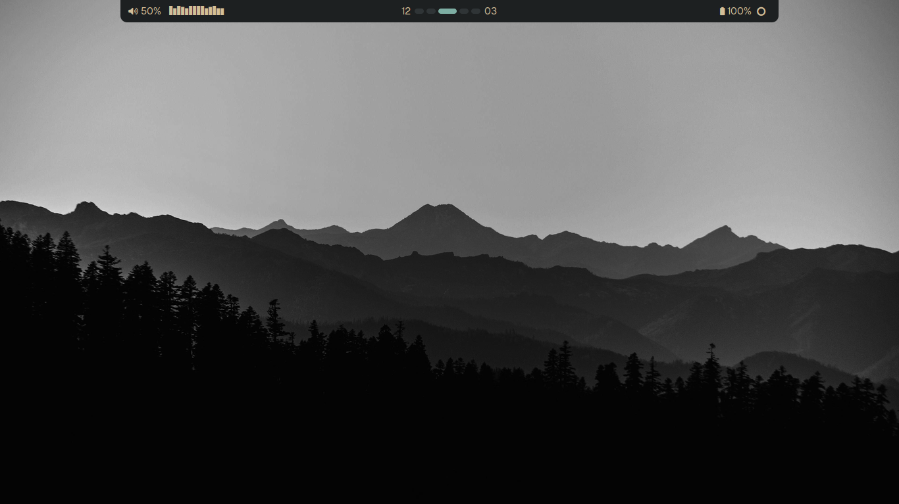
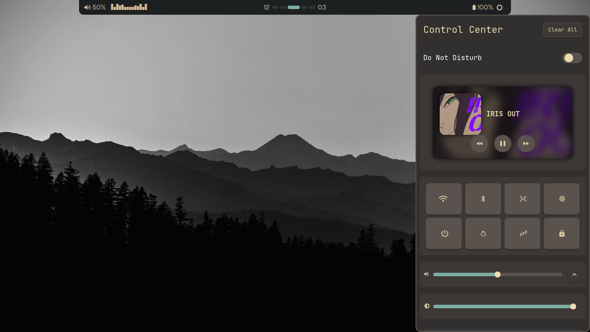
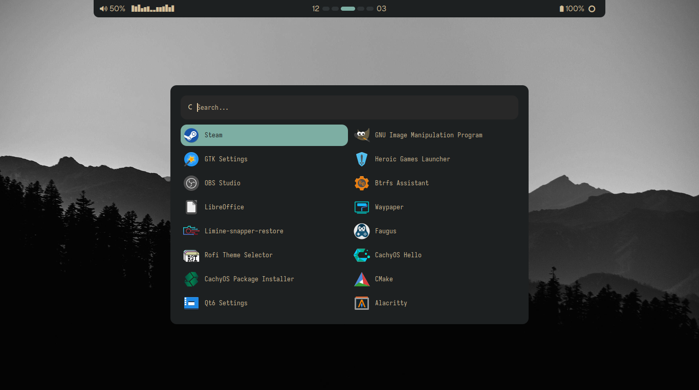

# My Hyprland Dotfiles

My personal Hyprland setup on CachyOS.

## Screenshots







## What's Inside

| Config | Purpose |
|--------|---------|
| `hypr` | Hyprland window manager |
| `waybar` | Status bar |
| `swaync` | Notification daemon |
| `rofi` | Application launcher |
| `kitty` | Terminal emulator |
| `fish` | Shell |
| `starship` | Shell prompt |
| `cava` | Audio visualizer |
| `uwsm` | Session manager |
| `nmrs` | Wi-Fi management |
| `qt6ct` | qt6ct config |
| `GTK-3.0` | GTK config |
| `GTK-4.0` | GTK config |
| `Gruvbox-Material-Dark` | GTK theme |

## Keybindings

`mainMod` = `SUPER`.

| Key | Action | Key | Action |
|-----|--------|-----|--------|
| `SUPER + Return` | Terminal | `SUPER + Q` | Close window |
| `SUPER + E` | File manager | `SUPER + F` | Fullscreen |
| `SUPER + Space` | Launcher | `SUPER + G` | Float |
| `SUPER + B` | Browser | `SUPER + M` | Maximize |
| `SUPER + T` | Text editor | `SUPER + L` | Lock screen |
| `SUPER + 1-9` | Workspace 1-9 | `SUPER + W` | Wallpaper |
| `SUPER + SHIFT + 1-9` | Move to workspace | `SUPER + V` | Clipboard |
| `SUPER + O` | Resources | `SUPER + P` | Color picker |
| `SUPER + ←/→/↑/↓` | Focus window | `SUPER + R` | Reload Waybar |
| `SUPER + ALT + ←/→/↑/↓` | Resize | `Print` / `SUPER + S` | Screenshot |
| `CTRL + ALT + ←/→/↑/↓` | Move window | `SUPER + Tab` | Next workspace |

## Requirements

- Hyprland
- Waybar
- SwayNC
- Hyprlock
- Hyprpicker
- Fish shell
- Rofi
- Kitty
- VScodium
- kate
- Starship
- Cava
- Thunar
- Resources
- awww
- nmrs
- Blueman
- Vivaldi browser
- vim

Supported distros for auto-install: **CachyOS / Arch**.

## Automatic installation

Clone this repository and run the installation script.

```bash
git clone https://github.com/Ario0o/dot-files ~/dot-files
cd ~/dot-files
./install.sh
```

If you prefer to only install the configuration files without installing any dependencies, run:

```bash
./install.sh --no-deps
```

If you'd like to use symlinks instead, run:

```bash
./install.sh --symlink

# install symlink files without installing dependencies
./install.sh --symlink --no-deps
```

The script will:
- Detect your distribution (auto-install supported for **Arch / CachyOS**)
- Install configs into `~/.config/` and themes into `~/.themes/`, backing up anything it overwrites to `~/.dotfiles-backup-<timestamp>`.

## Manual installation

> [!WARNING]
> The commands in this section are written for **bash**. If your login shell is fish, zsh, or anything else, run `bash` first to open a bash session, then paste the commands below. Type `exit` when you're done.

### Clone the repository

```bash
git clone https://github.com/Ario0o/dot-files.git
cd dot-files
```

### Install dependencies

```bash
sudo pacman -S --needed --noconfirm \
    hyprland swaync uwsm rofi-wayland kitty fish starship awww git \
    thunar thunar-archive-plugin thunar-volman file-roller gvfs gvfs-mtp \
    gthumb vivaldi cava brightnessctl playerctl grim slurp wl-clipboard \
    cliphist pipewire pipewire-pulse wireplumber pavucontrol pamixer base-devel \
    blueman bluez bluez-utils vscodium kate xdg-desktop-portal-hyprland \
    xdg-desktop-portal-gnome qt5-wayland qt6-wayland ttf-jetbrains-mono-nerd \
    noto-fonts noto-fonts-emoji papirus-icon-theme vim polkit-gnome qt6ct \
    breeze kvantum resources batsignal hyprpicker hyprlock imagemagick
```

### Install an AUR helper

In CachyOS:

```bash
sudo pacman -S paru

# or

sudo pacman -S yay
```

In Arch, EndeavourOS, Manjaro:

```bash
git clone https://aur.archlinux.org/paru.git
cd paru
makepkg -si
cd ~/dot-files
```

### Install AUR packages

```bash
paru -S --needed waybar-cava-git otf-geist-mono-nerd bibata-cursor-theme nmrs-bin

# or

yay -S --needed waybar-cava-git otf-geist-mono-nerd bibata-cursor-theme nmrs-bin
```

### Back up existing configs

Move any existing config you want to keep into a backup folder before copying.

```bash
BACKUP="$HOME/.dotfiles-backup-$(date +%Y%m%d-%H%M%S)"
mkdir -p "$BACKUP/.config" "$BACKUP/.themes"

[ -e "$HOME/.config/hypr" ] && mv "$HOME/.config/hypr" "$BACKUP/.config/"
[ -e "$HOME/.config/cava" ] && mv "$HOME/.config/cava" "$BACKUP/.config/"
[ -e "$HOME/.config/fish" ] && mv "$HOME/.config/fish" "$BACKUP/.config/"
[ -e "$HOME/.config/gtk-3.0" ] && mv "$HOME/.config/gtk-3.0" "$BACKUP/.config/"
[ -e "$HOME/.config/gtk-4.0" ] && mv "$HOME/.config/gtk-4.0" "$BACKUP/.config/"
[ -e "$HOME/.config/kitty" ] && mv "$HOME/.config/kitty" "$BACKUP/.config/"
[ -e "$HOME/.config/rofi" ] && mv "$HOME/.config/rofi" "$BACKUP/.config/"
[ -e "$HOME/.config/swaync" ] && mv "$HOME/.config/swaync" "$BACKUP/.config/"
[ -e "$HOME/.config/uwsm" ] && mv "$HOME/.config/uwsm" "$BACKUP/.config/"
[ -e "$HOME/.config/qt6ct" ] && mv "$HOME/.config/qt6ct" "$BACKUP/.config/"
[ -e "$HOME/.config/waybar" ] && mv "$HOME/.config/waybar" "$BACKUP/.config/"
[ -e "$HOME/.config/starship.toml" ] && mv "$HOME/.config/starship.toml" "$BACKUP/.config/"

[ -e "$HOME/.themes/Gruvbox-Material-Dark" ] && mv "$HOME/.themes/Gruvbox-Material-Dark" "$BACKUP/.themes/"
[ -e "$HOME/.themes/Gruvbox-Material-Dark-HIDPI" ] && mv "$HOME/.themes/Gruvbox-Material-Dark-HIDPI" "$BACKUP/.themes/"
```

### Copy the config folders

```bash
mkdir -p ~/.config
cp -a dotfiles/.config/{cava,fish,gtk-3.0,gtk-4.0,hypr,kitty,rofi,swaync,uwsm,qt6ct,waybar,starship.toml} ~/.config/
```

### Copy the themes

```bash
mkdir -p ~/.themes
cp -a dotfiles/.themes/Gruvbox-Material-Dark ~/.themes/
cp -a dotfiles/.themes/Gruvbox-Material-Dark-HIDPI ~/.themes/
```

### Make the Hyprland scripts executable

```bash
chmod +x ~/.config/hypr/scripts/*.sh
```

### Set the GTK and icon themes

```bash
gsettings set org.gnome.desktop.interface gtk-theme "Gruvbox-Material-Dark"
gsettings set org.gnome.desktop.interface icon-theme "Papirus"
```

### Make Fish your login shell (optional)

```bash
FISH_PATH="$(command -v fish)"
grep -Fxq "$FISH_PATH" /etc/shells || echo "$FISH_PATH" | sudo tee -a /etc/shells
chsh -s "$FISH_PATH"
```

## Update config

If you want to update your dots to a newer version without changing your config files, run:

```bash
./update_config.sh
```

## Credits

Originally based on
[babyanonymouse/Zero_Drag.dotfiles](https://github.com/babyanonymouse/Zero_Drag.dotfiles).

Gruvbox material themes from
[TheGreatMcPain/gruvbox-material-gtk](https://github.com/TheGreatMcPain/gruvbox-material-gtk).